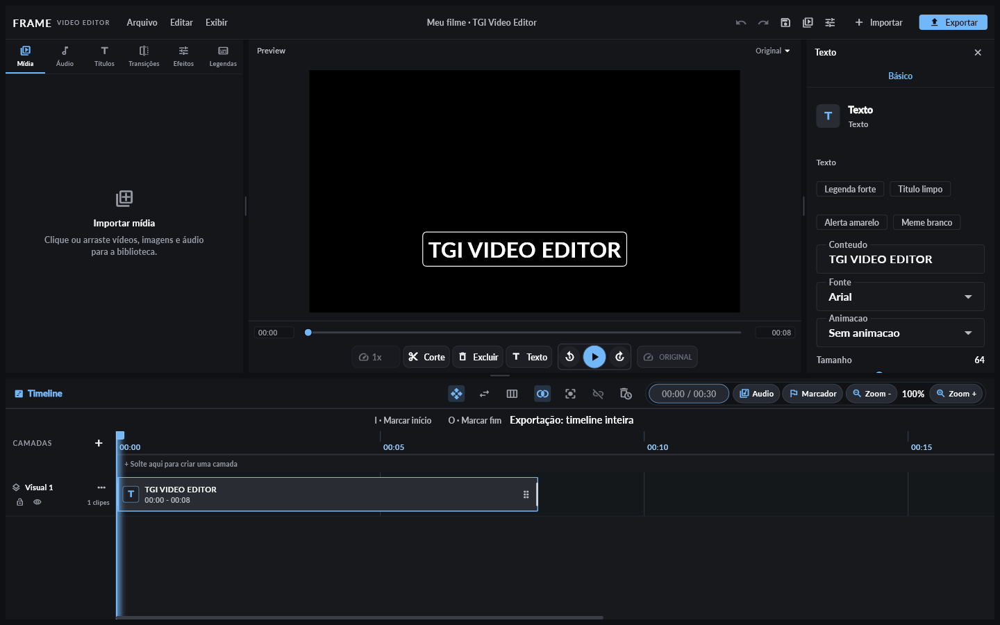
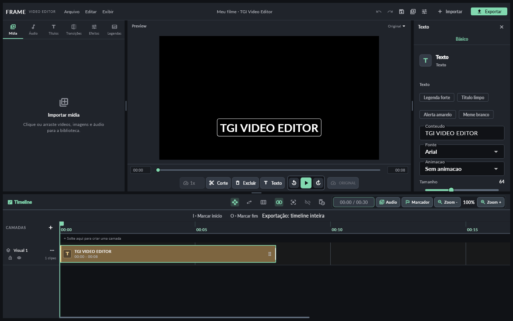
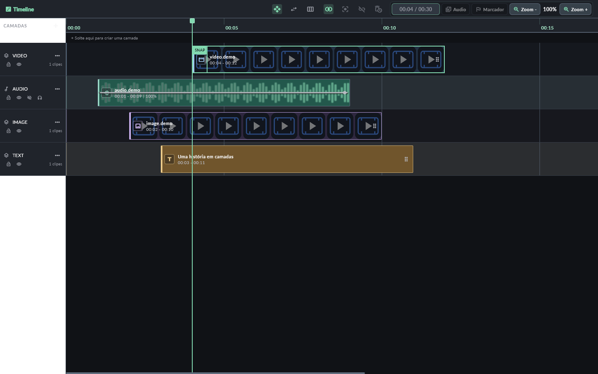
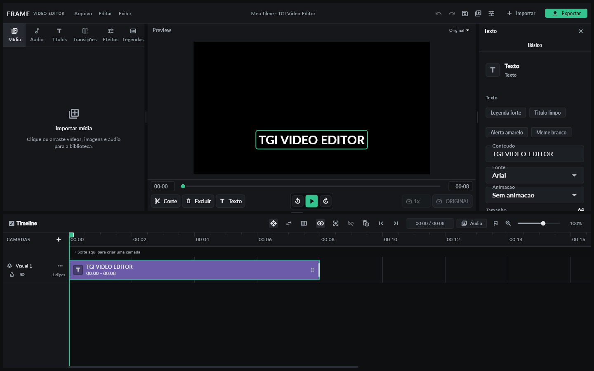
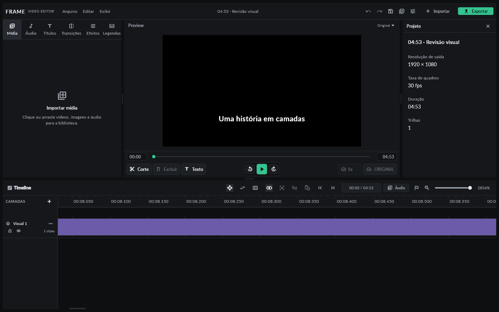
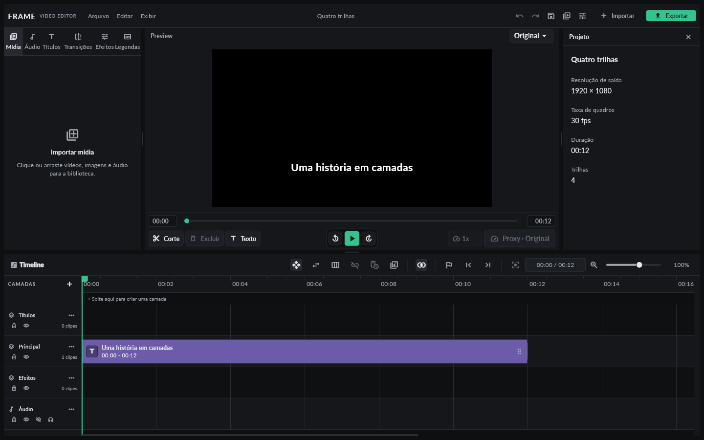

# Relatório de alterações

A revisão mais recente está em [Compactação do catálogo MCP](#mcp-catalog-compact).
A [Release 0.4.0](#release-040) registra as evidências da última publicação.
Os resultados das etapas
anteriores permanecem como histórico, vinculados aos respectivos commits.

O texto completo, incluindo os resultados remotos da release 0.3.0, está
disponível neste arquivo do repositório público. Não é necessário baixar
um asset de release para lê-lo. Os registros abaixo identificam o SHA que
foi executado; esta publicação posterior serve para facilitar a revisão.

Execução por etapas na ordem solicitada (a lista recebida não contém etapa 2).
Formato de projeto preservado em v14. Resultados locais e remotos são identificados em cada seção. Logs locais
completos ficam em `.work/`, ignorada pelo Git.

| Etapa | analyze --no-pub | test --no-pub | Resultado |
| --- | --- | --- | --- |
| 1 — Paridade | exit 0, sem problemas | exit 0, 138 aprovados / 13 ignorados | Frames FFmpeg, correção de dessaturação por máscara e docs/PARIDADE.md |
| 3 - Refatoracao | exit 0, sem problemas | exit 0, 141 aprovados / 13 ignorados | Builder puro, executor/parser, historico, legendas, preview e atalhos |
| 4 — Independente | exit 0, sem problemas | exit 0, 144 aprovados / 13 ignorados | Flag standalone padrão, 4K livre, rede TGI bloqueada e identidade central |
| 5 — Transições | exit 0, sem problemas | exit 0, 146 aprovados / 13 ignorados | xfade/acrossfade com pixels, duração e espectro de áudio; preview A/B aproximado |
| 6 — Projetos antigos | exit 0, sem problemas | exit 0, 148 aprovados / 13 ignorados | Sobreposições migradas em memória; formatos 13/14 e round-trip testados |
| 7 — Build e CI | exit 0, sem problemas | exit 0, 148 aprovados / 13 ignorados | Integração adicional: 161 aprovados; build release exit 0 (116,0 s) |
| 8 — Desempenho | exit 0, sem problemas | exit 0, 151 aprovados / 13 ignorados | Caches persistentes e benchmark FFmpeg executado; dados em docs/DESEMPENHO.md |
| 9 — Extras e entrega | exit 0, sem problemas | exit 0, 160 aprovados / 13 ignorados | Integração: 173 aprovados, zero ignorados; build release exit 0 (110,4 s) |

Os 13 testes históricos opcionais dependem de um dart-define e são ignorados
pelo comando padrão pedido. Os seis novos testes de pixels rodam por padrão.
A etapa 1 teve falhas intermediárias nos testes novos; foram corrigidas e os
dois comandos repetidos antes do commit. Asserções de máscara respeitam o
escurecimento por luminância YUV, que difere do preview RGB.

Ainda requer teste manual: janela nativa, reprodução, GPU, sincronismo
audiovisual percebido e diferenças de rasterização descritas em docs/PARIDADE.md.

## Etapa 3

<!-- Resultados das etapas 10/11 e capturas estão no fim deste relatório. -->

APIs de FfmpegService e EditorController preservadas. Testes anteriores
permanecem sem edicao. O builder nao escreve arquivos nem inicia processos;
os textos do drawtext sao retornados no comando e escritos pelo executor.
Novos testes verificam ausencia de escrita, determinismo, parser e historico.
Controlador e tela continuam orquestrando varios fluxos. Os novos modulos sao
bibliotecas importaveis, com dependencias explicitas, alem dos parts existentes.

## Etapa 4

`app/app_identity.dart` concentra nome, nome curto, diretório de dados e
`kStandalone` (padrão true). A marca exibida é Frame Studio. O diretório antigo
foi preservado para manter rascunhos/configurações. O nome pode ser configurado
por `EDITOR_NAME` / `EDITOR_SHORT_NAME` nos dart-defines.

No modo independente, 4K não exige conta/plano; autenticação, anúncios,
downloads TGI e instalação de modelos pela interface não fazem requisições.
Importação/edição/exportação usam arquivos locais. Catálogos remotos não são
necessários; o painel Áudio abre a biblioteca local. Assets já em cache ainda
podem ser usados. Instalar dependências exige preparação online ou cópia dos
runtimes; execução offline pressupõe esses componentes instalados.

Testes novos verificam 4K, autenticação sem HTTP e rejeição de downloads antes
da requisição. Não foi executada uma sessão nativa com o adaptador de rede
desligado; esse teste manual continua pendente.

## Etapa 5

Dissolve em emendas de vídeos adjacentes usa xfade/acrossfade antes da
codificação; duração da timeline preservada. O modelo v14 de transição global
foi mantido. O preview usa dois vídeos com mistura alfa. Handles repetem bordas;
os limites e diferenças estão em docs/PARIDADE.md. Não foi implementado um
modelo novo de transições por par/pista nem edição de handles fora do trim.

## Etapa 6

A migração agora separa vídeos sobrepostos automaticamente, incluindo v14
anteriores, sem mudar o número do formato. IDs de clipe, vínculos, tempos e
propriedades preservados; IDs das pistas adicionais não colidem com existentes.
O teste antigo de rejeição foi alterado nesta etapa porque o comportamento
pedido mudou. Detalhes em docs/MIGRACAO.md.

## Etapa 7

Scripts compartilhando o mesmo caminho curto; setup automático com versões e
SHA-256 fixados; CI Windows/Flutter 3.44.4. Download completo de FFmpeg, Whisper
e Base executado em `.work/setup-verification`, seguido de segunda execução
idempotente. FFmpeg/ffprobe `-version` e Whisper `--help` retornaram 0; hash do
Base conferido. A primeira verificação de ffprobe interrompia seu stdout com
Select-Object; foi corrigida e o setup repetido com sucesso.

`tool/test_editor.ps1 -Integration -Build` executou pub get, analyze, suíte
padrão, integração e build release. Houve avisos CMake CMP0175 do plugin
media_kit, sem falha de build. Prova de limpeza após exceção também executada
com o helper de caminho curto. Scripts PowerShell passaram pelo parser.
O resultado remoto do workflow será registrado separadamente ao final.

## Etapa 8

Proxies existentes foram aprimorados: diretório persistente, chave SHA-256,
publicação somente após conclusão e proporção vertical preservada. Miniaturas
e waveform agora usam cache em disco, com testes de reabertura, invalidação e
corrupção. Benchmark real de geração/decodificação/exportação de fonte sintética
1080p/5 s executado: uma medição por operação, números brutos publicados.
Não se mediram FPS nativo, consumo de GPU/RAM ou desempenho prolongado em 4K.

## Etapa 9

Presets YouTube/4K/9:16/1:1/WAV na interface; seleção de CPU/NVENC/QSV/AMF
mantida com probe e retry CPU. Testes renderizaram as quatro dimensões reais,
inclusive 3840×2160, e conferiram WAV PCM estéreo sem vídeo. Falhas simuladas
de cada encoder e falha após probe produziram arquivos CPU válidos.

Importação SRT com BOM, CRLF e texto multilinha; estilo em lote com fonte,
tamanho, cor, fundo e posição; undo/redo e pistas bloqueadas. Exportação SRT/VTT
existente reaproveitada. A tela de atalhos foi preservada, ampliada com referência
às combinações adicionais e testada com remapeamento por eventos reais.

A configuração da marca também gera SVG/PNG/ICO e cabeçalho Windows, corrigindo
o ícone e metadados nativos que ainda exibiam TGI. A última execução de
`tool/test_editor.ps1 -Integration -Build`, depois dessa correção, concluiu:

- `flutter pub get`: exit 0.
- `flutter analyze --no-pub`: exit 0, sem problemas (6,0 s).
- `flutter test --no-pub`: exit 0, 160 aprovados e 13 opcionais ignorados.
- Testes com `TGI_RUN_FFMPEG_INTEGRATION_TESTS=true`: exit 0, 173 aprovados,
  sem falhas/ignorados. O render real registrou CPU e NVIDIA NVENC nesta máquina.
- `flutter build windows --release --no-pub`: exit 0, 110,4 s; avisos CMake do
  plugin media_kit continuam presentes.
- 64 arquivos do build copiados para `aplicativo/` e comparados por SHA-256,
  sem divergências. ProductName/FileDescription/CompanyName do executável lidos
  e confirmados como Frame Studio. Versão de pacote mantida em 0.2.0+2.
- Todos os scripts PowerShell passaram pelo parser, inclusive o gerador da marca.

Logs finais: `.work/etapa9-final-branded-checks-build.log`. A opção somente áudio
é transitória e não adiciona campos ao projeto; testes confirmam leitura e
round-trip do v14. Detalhes de uso e limites: docs/EXTRAS.md.

## CI remoto executado

O [workflow da etapa 7](https://github.com/Losfodabr12/tgi-video-editor/actions/runs/39405929902)
terminou com **success** em windows-latest, Flutter 3.44.4: setup das ferramentas,
pub get, analyze, testes padrão, integração e build. Esse run corresponde ao
commit `4ab5d0b`, anterior às etapas 8/9; não é apresentado como validação remota
dessas alterações posteriores. O status do commit mais recente fica em
[Actions](https://github.com/Losfodabr12/tgi-video-editor/actions/workflows/ci.yml).

## Limites e trabalho não realizado

- A revisão de paridade documenta aproximações; não há garantia de pixels
  idênticos entre Flutter/media_kit e todos os filtros FFmpeg.
- Dissolves respeitam o modelo global v14. Não foram criados transições por
  par/pista com novo schema nem handles externos ao trim; bordas são repetidas.
- Controlador e tela foram divididos por responsabilidades, mas ainda concentram
  fluxos de orquestração. Não houve reescrita total da arquitetura ou mudança
  de framework de estado.
- Não há quota automática para todos os caches; o benchmark usa uma fonte
  sintética de 5 s e uma medição por operação. Não é benchmark de FPS da UI.
- Só áudio usa WAV PCM. SRT transporta texto/tempo, não o estilo visual do projeto.
- Não se validou hardware Intel QSV ou AMD AMF real. Seus caminhos de falha e
  fallback foram simulados; o render CPU de fallback foi executado de verdade.
- A etapa 11 acrescenta publicação Windows por tag; o resultado executado fica
  na seção da etapa 11 e no relatório que acompanha o artefato/release.

## Sessão manual ainda necessária na janela nativa

Não foi executada uma sessão audiovisual manual nesta tarefa. Ainda é preciso
conferir reprodução/seek e sincronismo percebido, dissolve com efeitos/camadas,
qualidade das bordas de chroma/máscaras, diálogos e escalas de tela, captura de
atalhos, fluxo de importação SRT/estilo e destinos de exportação. Também faltam
edição prolongada/4K com mídia de câmera, CPU/GPU/RAM em uso real, exportações
longas por fabricante de GPU, transcrição de voz completa com Whisper e uma
sessão com o adaptador de rede desligado. Build/testes não substituem esses usos.


## Etapa 10 — Visual

Concluída antes de iniciar a etapa 11. Tokens únicos em
`source/lib/app/theme/design_tokens.dart`: superfícies `#101216`, `#20242B`,
`#343B46`, destaque `#82D9B0`, espaçamento em múltiplos de 4 e raios 2/4/6.
Interface com Lato regular/bold incluída no pacote (OFL), Material Icons,
`VisualDensity.compact`, bordas finas e sem sombras/gradientes decorativos.
As fontes e efeitos escolhidos para o conteúdo do vídeo foram preservados.

Timeline com cores por tipo, thumbnails, waveform, régua e playhead sem blur.
O snapping exibe uma borda e a indicação SNAP no ponto correspondente.
Os divisores existentes foram preservados e ganharam identificação para testes;
o arraste dos três divisores e a restauração após fechar/reabrir o editor foram
executados com gravação real em um arquivo de preferências isolado. Nenhuma
alteração no formato v14: dimensões ficam em `editor_layout.json`.

Foram adicionados cinco goldens headless: editor vazio, propriedades de texto,
exportação, atalhos e timeline com snapping ativo. O teste da timeline espera
as imagens decodificarem, fornece samples determinísticos de áudio, arrasta um
clipe e verifica o encaixe real em 4 s. O bootstrap dos testes carrega os bytes
da fonte usada no app; os testes anteriores continuam sem edição.

Comandos finais executados pelo drive curto do build:

- `flutter analyze --no-pub`: exit 0, sem problemas, 3,6 s.
- `flutter test --no-pub`: exit 0, 167 aprovados / 13 opcionais ignorados, 19 s.
- `flutter test --no-pub test/visual_golden_test.dart --update-goldens`:
  exit 0; referências geradas. A suíte completa acima comparou essas referências
  novamente, sem `--update-goldens`, e passou.
- Logs: `.work/etapa10-analyze.log`, `.work/etapa10-test.log`.

Houve falhas intermediárias de overflow e de altura do transporte; foram
corrigidas no código e a suíte inteira foi repetida. Não se avançou para a
etapa seguinte com falhas. As capturas abaixo foram renderizadas pelos widgets
reais a 1440×900; não são fotos de uma sessão na janela nativa. O texto TGI da
cena é conteúdo do projeto histórico de teste, igual nas duas capturas.

| Antes | Depois |
| --- | --- |
|  |  |



Detalhes e reprodução em [docs/VISUAL.md](docs/VISUAL.md). DPI/monitores,
interação contínua com mouse e reprodução audiovisual ainda exigem a janela
nativa.


## Etapa 11 — Release 0.3.0

Versão do pacote elevada para **0.3.0+3**; versão do projeto permanece **14**.
CI Windows / Flutter 3.44.4 agora empacota o build e publica ZIP, SHA256SUMS e
relatório como artefato. `release.yml`, disparado por tag `v*`, reutiliza esse
mesmo CI e publica GitHub Release apenas depois do sucesso do build. Tag e
versão do executável/pubspec precisam corresponder. Checkout 7.0.1, cache
6.1.0, upload 7.0.2 e download 8.0.2 usam Node 24; os manifests foram lidos
pela API do GitHub. O cache interno da action Flutter usa cache v5 / Node 24.

Ao sobrescrever projeto migrado, o original fica em `.bak`, sem reserializar
seus bytes. Gravações seguintes preservam esse primeiro backup. A proteção
cobre formatos anteriores, sobreposições de versões iniciais do v14 e grupos
de legendas normalizados, sem novos campos de projeto. Os novos testes
executaram v13/v14, Save As, concorrência, persistência por outra instância e
entrada corrompida; os testes anteriores de falha e rollback também passaram.

`tool/test_editor.ps1 -Integration -Build` executado pelo mesmo caminho curto:

| Comando | Resultado local final |
| --- | --- |
| `flutter pub get` | exit 0 |
| `flutter analyze --no-pub` | exit 0, sem problemas, 5,9 s |
| `flutter test --no-pub` | exit 0, 172 aprovados / 13 opcionais ignorados, 25 s |
| `flutter test --no-pub --dart-define=TGI_RUN_FFMPEG_INTEGRATION_TESTS=true` | exit 0, 185 aprovados / zero ignorados, 30 s |
| `flutter build windows --release --no-pub` | exit 0, 113,4 s |

Log: `.work/etapa11-checks-build.log`. Os avisos CMake CMP0175 do media_kit
continuam presentes; não são avisos de Node 20. Os scripts PowerShell também
passaram pelo parser. A comparação dos goldens é parte das duas suítes acima.

A última repetição ao fim da etapa também passou: analyze sem problemas
(5,1 s) e 172 testes padrão aprovados / 13 opcionais ignorados (27 s).
Logs: `.work/etapa11-final-analyze.log`, `.work/etapa11-final-test.log`.

O ZIP local foi gerado, extraído e seus **91 arquivos** conferidos contra o
manifesto SHA-256. Executável extraído: ProductVersion **0.3.0+3**.
FFmpeg `-version` e Whisper CLI `-h` extraídos executados com exit 0. Isso
verifica inicialização dos runtimes, não transcrição completa de voz.
`aplicativo/` foi atualizado e os mesmos 91 arquivos foram comparados, sem
divergências. ZIP local de conferência: 251.917.295 bytes, SHA-256
`b94863027e3c775085aa6ecc8a72cbd58f55eb20a7bd3ce5f74e5c0037a43b43`.
Esse ZIP foi criado antes do commit da etapa 11; o manifesto registra essa
condição com `workingTreeDirty`. O CI recompila o commit final e gera seu
próprio ZIP/checksum; não se presume igualdade binária entre máquinas.
Log: `.work/etapa11-package.log`.

### FFmpeg baixado e licença

Build fixado **8.1.2-essentials_build-www.gyan.dev**, Windows x64 estático,
GCC 16.1.0, [ZIP Gyan 8.1.2](https://github.com/GyanD/codexffmpeg/releases/download/8.1.2/ffmpeg-8.1.2-essentials_build.zip).
SHA-256 do ZIP baixado conferido novamente:
`db580001caa24ac104c8cb856cd113a87b0a443f7bdf47d8c12b1d740584a2ec`.
`ffmpeg -version` e `ffmpeg -L` foram executados; configuração contém
`--enable-gpl --enable-version3 --enable-static`. Licença declarada pelo
executável: **GNU GPL v3 ou posterior**. O pacote preserva LICENSE/README.
Fontes do build: commit FFmpeg `38b88335f9`, indicado no README do distribuidor.
Detalhes e links em [docs/THIRD_PARTY.md](docs/THIRD_PARTY.md).

### Contagem pedida, executada com wc

Comando real (`wc.exe` do Git for Windows):

```text
wc -l source/lib/services/ffmpeg_service.dart source/lib/features/editor/application/editor_controller.dart source/lib/features/editor/presentation/editor_screen.dart
  2267 source/lib/services/ffmpeg_service.dart
  6072 source/lib/features/editor/application/editor_controller.dart
  3689 source/lib/features/editor/presentation/editor_screen.dart
 12028 total
```

Esses números deixam explícito que controlador e tela ainda são grandes,
apesar da extração de módulos nas etapas anteriores. Não se declara uma
reescrita completa deles. Log: `.work/etapa11-wc.log`.

### Evidência remota e entrega

A etapa visual `403aabf` também passou no
[CI remoto](https://github.com/Losfodabr12/tgi-video-editor/actions/runs/39497056306).
O CI gerou **depois dos comandos** uma cópia deste relatório com o SHA exato
e o run executado. O resultado concluído está transcrito integralmente abaixo,
para leitura direta no repositório. Há também cópias no ZIP, no artefato
`frame-studio-windows-x64` e na release.
[Workflow e runs](https://github.com/Losfodabr12/tgi-video-editor/actions/workflows/ci.yml).

<!-- CI_RESULT_START -->
## Resultado remoto do commit da release — conferido após conclusão

Commit **`e407885c086d4d06b49f0925bb14100965f60c44`**, tag **v0.3.0**.
Estado consultado pela API do GitHub depois de ambos os workflows terminarem:

| Execução | Estado remoto final |
| --- | --- |
| [CI da branch main — 39498721935](https://github.com/Losfodabr12/tgi-video-editor/actions/runs/39498721935) | **completed / success** |
| [Release por tag — 39498725045](https://github.com/Losfodabr12/tgi-video-editor/actions/runs/39498725045) | **completed / success**, jobs build e publish aprovados |

Logs remotos lidos: analyze sem problemas (17,3 s no CI main), **172 testes
padrão aprovados / 13 opcionais ignorados**, **185 aprovados com integração**,
build Windows aprovado (168,6 s no CI main), empacotamento e upload aprovados.
A execução da tag registrou os mesmos totais de testes. Busca nos logs dos
dois runs por Node.js 20 / Node20 / node20: **zero ocorrências**. Os avisos
CMake do media_kit continuam presentes. O watcher auxiliar encontrou HTTP 502
nas anotações; a consulta direta posterior e os logs confirmaram sucesso.

Artefato do CI main: `frame-studio-windows-x64`, ID **12299935483**, 299.080.856
bytes, disponível no run. [Release publicada](https://github.com/Losfodabr12/tgi-video-editor/releases/tag/v0.3.0),
sem draft/prerelease. O ZIP da release foi baixado e extraído nesta máquina:

- `FrameStudio-0.3.0-windows-x64.zip`: **299.061.481 bytes**.
- SHA-256: `e5de95a56b701ffde863ad3bda9bc26bb768d712bbe57830a6616f4f8db99be3`,
  igual a SHA256SUMS.txt e ao digest informado pelo GitHub.
- **120 arquivos** conferidos contra o manifesto do ZIP, sem divergências.
- `BUILD_INFO.json` identifica o commit acima; ProductVersion do EXE
  extraído **0.3.0+3**. O manifesto registra `workingTreeDirty=true` após a
  preparação; o diff remoto não foi capturado, portanto não se afirma que
  todos os arquivos gerados pelo build permaneceram iguais ao checkout.
- FFmpeg extraído: **8.1.2-essentials_build-www.gyan.dev**; `-version` e `-L`
  executados com exit 0, GPL v3 ou posterior confirmado no binário.
- Whisper CLI extraído: `-h` executado com exit 0. Não houve transcrição
  completa de voz nem sessão audiovisual manual na janela nativa.

Este resultado pós-CI foi incorporado ao relatório local, ao asset da release
e agora ao texto versionado, a pedido de disponibilizar a leitura sem assets.
As etapas 10 e 11 foram entregues em commits separados; esta publicação
adicional contém documentação. As aprovações acima correspondem ao commit
`e407885`, identificado nos dois runs, e não são apresentadas como resultados
de uma nova execução para este commit posterior de documentação. O relatório
dentro do ZIP registra os checks quando executados e aponta para o mesmo run.

Evidências locais: `.work/final-ci-remote.log`, `.work/final-release-remote.log`,
`.work/final-remote-results.json`, `.work/final-package-results.json`.
<!-- CI_RESULT_END -->

### Teste manual ainda necessário

Não foi executada sessão audiovisual na janela nativa. Continuam pendentes
playback/seek e sincronismo percebido, DPI/monitores, interação contínua com
mouse, exportação longa por fabricante de GPU, transcrição completa de voz e
uso com adaptador de rede desligado. O ZIP conter runtimes locais e CRT não
substitui teste em uma instalação Windows limpa. Goldens são headless.

## Ajuste visual adicional — 20 de outubro de 2026

Alteração preparada como um único commit sobre `54252ac`. O formato v14,
os modelos, os tempos dos clipes e o export permanecem preservados; nenhum
arquivo de domínio ou serviço de persistência foi alterado neste ajuste.

### O que mudou

1. Tokens centralizados com fundo `#0E0F11`, painéis `#15171A`, controles
   `#1C1F23`, hover `#262A30`, bordas `#2A2E34`, texto `#E6E8EB`, secundário
   `#A0A7B1` e destaque `#34C38F`. Clipes foscos de vídeo `#3B5B8C`, áudio
   `#2F7D6B`, texto `#6B5BA8` e efeitos/transições `#A0653B`. Imagens usam
   o azul dos visuais. Saíram o dourado do texto e as bordas bege. A seleção
   mantém a cor do tipo e recebe contorno verde de 2 px, também no preview.
   Toggles ligados usam superfície elevada neutra; ícones auxiliares,
   sliders, waveform e indicadores de ferramentas deixaram de usar verde.
   A seleção por retângulo perdeu o blur e usa contorno de 2 px.
2. Abas da biblioteca passaram de 9 para 12 px. Rótulos secundários,
   controles pequenos, tempos do preview e indicadores de mídia ganharam
   tamanho/contraste. A aba Transições recebeu mais largura. Corte,
   Excluir e Texto usam o mesmo estilo, com rótulos de 13 px.
3. Layout padrão com aproximadamente 45% da altura de trabalho para a
   timeline. O mínimo considera cabeçalho/régua e três trilhas completas;
   testes conferem a principal entre elas em 1440×900 e 1280×720. Em janelas
   muito baixas ou trilhas muito altas ainda é necessário scroll. O resize
   e a persistência das proporções continuam funcionando. Sem seleção, o
   inspetor mostra nome, resolução de saída, fps, duração e número de trilhas.
4. Régua e grade escolhem intervalos pelo zoom, com pelo menos 96 px entre
   rótulos principais, milissegundos em detalhe e horas em projetos longos.
   Geram somente a faixa visível com margem, em vez de todos os rótulos do
   projeto. Teste cobre seis horas em cinco escalas diferentes.
5. Voltar/play/avançar ficam centralizados no preview. Ferramentas ocupam
   um grupo separado à esquerda; velocidade e proxy ficam à direita.
6. Slider logarítmico de zoom entre 0,5% e 3200%, preservando o ponto de
   referência e Ctrl + roda. A linha de instruções I/O saiu da timeline;
   ações e estado do trecho ficam nos tooltips dos ícones de marcar início/fim.
7. A diferença **04:53 / 04:58 era um bug no contador**: a timeline exibia
   `_timelineExtent`, que acrescenta cinco segundos de espaço de edição,
   enquanto o preview exibia `project.timelineDuration`. O contador agora
   recebe a duração real; somente o canvas mantém a folga. Um teste abre
   um projeto de 293 segundos e confere **04:53** no preview, timeline e
   propriedades. Os tempos do projeto e do arquivo exportado não mudaram.

Detalhes: [docs/VISUAL.md](docs/VISUAL.md). Preferências de layout continuam
separadas do projeto, em `editor_layout.json`, versão de layout 3.

### Antes e depois

Mesma cena, 1440×900, escala 1. Capturas reais de widgets headless com a
fonte e os ícones carregados do repositório/SDK. O título TGI é conteúdo
do projeto histórico de teste, mantido para permitir comparação.

| Antes deste ajuste | Depois deste ajuste |
| --- | --- |
|  |  |



### Validação executada neste ajuste

Windows, Flutter **3.44.4** / Dart **3.12.2**, pelo mesmo drive curto usado
no build. Todos os comandos abaixo terminaram com exit 0:

| Comando | Resultado real |
| --- | --- |
| `flutter test --no-pub test/visual_golden_test.dart test/visual_refinement_test.dart --update-goldens` | **13 aprovados**, 8 s; seis imagens golden atualizadas, incluindo a nova régua ampliada |
| `flutter analyze --no-pub` | **Sem problemas**, 12,6 s |
| `flutter test --no-pub` | **178 aprovados / 13 opcionais ignorados**, 27 s; comparação dos goldens executada sem `--update-goldens` |
| `flutter build windows --release --no-pub` | **Build Windows aprovado**, 53,1 s |

Os cinco testes novos de regressão conferem duração real, layout com três
trilhas, centralização, seleção de 2 px no preview/timeline, mudança da
régua pelo slider e temas neutros. O sexto teste novo é o golden do zoom.
Os testes anteriores não foram editados, exceto as referências visuais e
a fixture de goldens que agora inclui uma transição para exibir sua cor.
Os 13 opcionais de integração não foram habilitados nesta execução local;
os testes padrão de pixels FFmpeg foram executados pela suíte completa.

Logs locais: `.work/visual-polish-goldens-final.log`,
`.work/ajuste-visual-analyze.log`, `.work/ajuste-visual-test.log`.
Build em `.work/ajuste-visual-build.log`. O conteúdo de
`source/build/windows/x64/runner/Release` foi copiado para `aplicativo/`:
**66 arquivos conferidos por SHA-256, zero divergências**. O launcher
`INICIAR EDITOR.cmd` usa esse aplicativo atualizado, versão **0.3.0+3**.
SHA-256 do código compilado `data/app.so`:
`49e5041df1e100c14c3c761a6ef7d4c57497df0fea4f62e86b481d5106faf2b3`.
Este é um build local preparado antes do commit; a tag e o ZIP histórico
da release v0.3.0 não foram substituídos. O aplicativo não foi aberto para
teste manual.

Os resultados remotos da release registrados acima pertencem ao commit
`e407885`; não validam automaticamente esta revisão visual. O CI do ajuste
`4cfb586` foi consultado posteriormente pela API e concluiu com
**completed / success**:
[run 39504938174](https://github.com/Losfodabr12/tgi-video-editor/actions/runs/39504938174).
Esse resultado pertence ao ajuste anterior; o novo ajuste curto tem outro run.

Contagem atual, comando `wc -l` executado novamente:

```text
  2267 source/lib/services/ffmpeg_service.dart
  6072 source/lib/features/editor/application/editor_controller.dart
  3698 source/lib/features/editor/presentation/editor_screen.dart
 12037 total
```

### Teste manual pendente deste ajuste

Não foi executada sessão audiovisual na janela nativa. Conferir em uso real
o contraste em outros monitores/DPI, arraste contínuo do slider e divisores,
playback/seek, tooltips I/O e a abertura com proporções de layout já salvas.
O padrão 45% não sobrescreve proporções personalizadas existentes; duplo
clique no divisor restaura o layout padrão. Goldens não validam drivers,
GPU nem sincronismo audiovisual percebido.

## Ajuste curto — legendas, layout e diagnóstico do CI

Um único commit sobre `4cfb586`, mantendo o formato de projeto **v14**.

- Textos novos, legendas rápidas/automáticas e importações SRT usam
  **Lato Bold, branco, contorno preto de 2 px e sombra curta a 45%**.
  No preview, o contorno acompanha o canvas e a sombra tem blur de 1 px
  na referência 720p; no export, o contorno tem 2 px de saída e a sombra
  usa o antialiasing da fonte, sem blur extra. O novo preset `Lato Caption`
  usa o campo `fontFamily` já existente. Defaults de desserialização,
  famílias antigas e seus estilos não foram alterados. A escolha explícita
  de outra fonte/preset continua disponível. Preview e diálogos de estilo
  usam o mesmo widget para esse preset.
- Quatro trilhas de 64 px cabem inteiras no layout padrão em 1440×900.
  Em 1280×720 há scroll vertical com scrollbar fixa na área visível,
  independente do zoom horizontal. O teste rola até o fim, confere o áudio
  inteiro e verifica alinhamento com seu cabeçalho. Há margem inferior de
  12 px. Sem trilhas, a scrollbar não tenta usar um controlador desconectado.
- Preferências de layout anteriores à versão 3, ou com menos de 45% para
  a timeline, são normalizadas para 45% e gravadas como layout v3. Não se
  trata de migração do arquivo de projeto. A altura mínima e a rolagem
  continuam funcionando em janelas menores. Proporções válidas são preservadas.
- Toolbar com divisores de edição / snapping / marcadores / navegação.
  Tooltips e tela de atalhos indicam V/Y/U, N, M, F, L, A, Shift+Delete,
  I/O, setas e Ctrl + roda. Os atalhos funcionam e respeitam campos de
  texto, diálogos e bindings personalizados existentes.
- Menu de qualidade/proxy com texto de 14 px, maior contraste e superfície
  elevada. Alças de texto usam a cor do clipe, clareiam no hover e mantêm
  a área de arraste. As alças de imagem mantêm sua cor anterior.
- Painéis laterais com padrão de **280 px** e mínimos de resize de
  200 px (biblioteca) / 220 px (inspetor), liberando espaço ao preview.
- CI passa a executar `git status --porcelain` e `git diff --stat` em um
  passo com `if: always()` logo após analyze/test/build. Isso permitirá
  identificar os arquivos que causam `workingTreeDirty=true`; a causa
  remota ainda não foi confirmada nesta revisão. Não se declara que o
  novo passo já rodou no GitHub antes do push.

### Capturas desta revisão

Goldens reais, headless, 1440×900. A comparação histórica do ajuste anterior
permanece acima; as imagens abaixo mostram os casos novos desta revisão.




### Comandos executados

Windows, Flutter 3.44.4 / Dart 3.12.2, caminho curto temporário do script de build:

| Comando | Resultado real |
| --- | --- |
| `flutter test --no-pub test/visual_golden_test.dart --update-goldens` | **10 aprovados**, 8 s; oito goldens, incluindo os dois novos |
| `flutter analyze --no-pub` | **Sem problemas**, exit 0, 3,8 s |
| `flutter test --no-pub` | **187 aprovados / 13 opcionais ignorados**, exit 0, 29 s; goldens comparados sem atualização |
| `flutter build windows --release --no-pub` | **Build Windows aprovado**, exit 0, 119,7 s |

O teste novo de FFmpeg exportou frames sobre fundos branco e preto e contou
pixels de contraste. O round-trip v14 preservou estilos antigos e o novo
preset. A rodada de regressão de layout/transporte teve **23 aprovados**.
Os testes anteriores permaneceram sem edição, exceto fixtures/referências
visuais e os dois casos acrescentados ao arquivo de goldens.

Houve falhas intermediárias: controlador de scrollbar sem trilhas e troca
de árvore durante inserção/undo foram corrigidos; o teste novo também exigiu
ajustes de timestamp e espera de I/O. Hooks nativos ficaram com um drive
temporário antigo após interrupção da rodada; `flutter clean` e `flutter pub get`
regeneraram os caches no mesmo caminho curto antes da repetição aprovada.
Uma captura isolada recebeu o ancestral Material para remover os sublinhados
de debug; os goldens e os dois comandos finais foram repetidos depois disso.

Logs: `.work/ajuste-curto-regressions.log`, `.work/ajuste-curto-goldens.log`,
`.work/ajuste-curto-analyze.log`, `.work/ajuste-curto-test.log`.
Os 13 opcionais de integração não foram habilitados localmente nesta rodada.
Os testes padrão de pixels FFmpeg foram executados.

O build foi copiado para `aplicativo/`: **65 arquivos comparados por SHA-256,
zero divergências**, ProductVersion **0.3.0+3**. O launcher local usa esse
build atualizado. A tag e o ZIP histórico v0.3.0 não foram substituídos.
Os avisos CMake CMP0175 do media_kit continuam presentes, sem impedir o build.
Log: `.work/ajuste-curto-build.log`; conferência da cópia em
`.work/ajuste-curto-local-build.json`. O executável não foi aberto para
sessão manual. `git status --porcelain` e `git diff --stat` também foram
executados localmente depois do build; logs em
`.work/ajuste-curto-status-after-build.log` e `.work/ajuste-curto-diff-after-build.log`.
O estado local incluía as alterações intencionais ainda não commitadas;
isso não identifica a causa do estado sujo no checkout remoto histórico.

`wc -l` foi executado novamente: FFmpeg service **2267**, controlador **6073**,
tela **3747** linhas; **12087** no total. Formato e serviços de persistência
do projeto não foram modificados.

Continua pendente teste audiovisual na janela nativa, contraste em monitores
e DPI diferentes, arraste contínuo de trim/scrollbar e uso com layout real
previamente salvo. Os resultados antigos de CI/release permanecem associados
aos SHAs identificados nas seções históricas.

## MCP integrado — 21 de outubro de 2026

Implementação local por etapas, com um commit por etapa. As etapas 1–8 foram
validadas com `flutter analyze --no-pub` e
`flutter test --no-pub --concurrency=1`. A concorrência 1 evita a corrida do
teste histórico de proxy automático que espera apenas 10 ms: houve falha na
rodada concorrente da etapa 1, seguida de aprovação isolada e da suíte inteira.
Nenhum teste anterior foi editado, nem mesmo imports. O diff dos testes contra
`88d60f0` contém somente arquivos adicionados.

| Etapa | Commit | Analyze | Testes padrão aprovados / ignorados |
| --- | --- | --- | --- |
| 1 — Comandos JSON Dart puro e revisão | `011e05f` | exit 0 | 190 / 13 |
| 2 — Transações e histórico compartilhado | `8e68b95` | exit 0 | 193 / 13 |
| 3 — Leituras, análises e jobs canceláveis | `ce4c27e` | exit 0 | 195 / 13 |
| 4 — Macros e preview/aplicação de planos | `d0f970b` | exit 0 | 198 / 13 |
| 5 — MCP Streamable HTTP e resource | `fd29075` | exit 0 | 201 / 13 |
| 6 — Segurança, credencial e auditoria | `897a0c9` | exit 0 | 203 / 13 |
| 7 — Configurações e atividade da IA | `90f430b` | exit 0 | 204 / 13 |
| 8 — Contratos, mídia e clientes externos | `965cc9d` | exit 0 | 215 / 13 |
| 9 — Documentação e entrega local | este commit | exit 0 | 215 / 13 |

O estado inicial foi verificado: análise limpa e **187 aprovados / 13 ignorados**.
Os resultados finais de cada etapa estão em `.work/mcp-stepN-analyze.log` e
`.work/mcp-stepN-test.log`, ignorados pelo Git. Resultados intermediários com
falhas não são tratados como aprovação.

`lib/core/commands` contém validação de schemas/IDs/limites, comandos
serializáveis, transações e histórico Dart puro. Os caminhos correspondentes da
UI usam esse núcleo, incluindo multisseleção, áudio e legendas. Uma transação
da IA cria um snapshot com rótulo e é desfeita com Ctrl+Z. Os testes comparam o
JSON v14 completo antes e depois do undo; lotes inválidos não deixam alterações.
Revisões são de sessão, monotônicas também em undo/redo e edições da UI; não
foram adicionadas ao arquivo de projeto. `ProjectIOService` e o formato v14
permanecem sem alteração.

Foram expostas **33 tools** e `editor://project/summary`. Leituras paginam clipes,
mídias e transcrições. Análises/exportação usam FFmpeg e Whisper existentes,
com fila de jobs e cancelamento. Macros geram snapshots exatos para revisão;
aplicação usa a mesma revisão e um único histórico. Reenquadramento inclui a
resolução na restauração do undo. Também foi corrigida a divisão de fonte em
grupos reversos, verificada por spans de vídeo/áudio e pixels da exportação real.

Servidor desligado ao iniciar, bind IPv4 loopback, bearer obrigatório, token
persistente via `flutter_secure_storage`, validações de Host/Origin, limites de
taxa/corpo/concorrência/sessões e auditoria de metadados sem segredo. A API aceita
IDs de mídia e basenames de exportação, com validação canônica de autorização e
sem sobrescrever destinos existentes. Testes rejeitam traversal, paths de rede,
arquivo externo e junction que escapa do diretório do projeto.

Uma revisão final encontrou uma corrida entre rotação de token e emergência:
a rotação pendente podia religar o servidor. Um teste novo reproduziu o erro
(`.work/mcp-emergency-race-before.log`); a correção foi incluída na etapa 8,
seguida de análise limpa e suíte completa aprovada. O app mantém o servidor
desligado nessa situação.

Na UI: Arquivo → Configurações de IA (MCP), porta, liga/desliga, pasta de
exportação, cópia de TOML/token, rotação, revisão/aprovação de planos, jobs,
atividade e desfazer. O indicador de conexão e a parada de emergência aparecem
quando ligado. Os goldens existentes passaram sem atualização de imagens.

### Cliente externo e MCP Inspector executados

Cliente independente **@modelcontextprotocol/sdk 1.32.1**, em processo Node,
conectou por HTTP real ao host Flutter de teste que usa os mesmos módulos do
app. Foram executados tools/list (33), get_project, resource, preview/apply/undo,
rejeição de base_revision antiga, bearer inválido (HTTP 401), exportação fora da
pasta autorizada, miniaturas PNG, LUFS, jobs de cenas/silêncio e exportação nativa.
O host confirmou o JSON do projeto idêntico ao original após desfazer.

Uma fala sintética foi produzida localmente pelo System.Speech para esse teste.
**Whisper Base real** executou a transcrição via MCP, com **3 cues** retornados
por get_transcript. O teste de mídia da suíte usa FFmpeg real e um transcritor
injetado; a execução de Whisper real foi separada, pelo cliente externo.

**MCP Inspector 2.11.0**, CLI, executou `tools/list --strict` e `get_project`:
ambos **exit 0**, sem avisos. SDK, Inspector e host concluíram com exit 0.
Resultado sem credenciais versionado em
[docs/validation/MCP_CLIENT_RESULT.json](docs/validation/MCP_CLIENT_RESULT.json).
Harness e cliente reproduzíveis:
`source/tool/mcp_inspector_host_test.dart` e `tool/mcp_client_smoke.mjs`.
Logs locais: `.work/mcp-external-host.log` e `.work/mcp-external-client.log`.

Essa validação externa usou projeto sintético e bearer temporário de teste;
não foi uma sessão interativa do Codex/Claude ou do editor Windows. A integração
do armazenamento seguro nativo não foi exercitada pelo host de teste. As
limitações de miniaturas, loudness, macros, paginação e protocolo estão em
[docs/MCP.md](docs/MCP.md).

### Build Windows local

Build release final do código `965cc9d` executado com o caminho curto do helper
`tool/editor_paths.ps1`: `flutter pub get` e
`flutter build windows --release --no-pub`, **exit 0**, compilação em **44,6 s**.
Os arquivos foram copiados para `aplicativo/`, usado por `INICIAR EDITOR.cmd`:
**66 arquivos conferidos por SHA-256, zero divergências**, ProductVersion
**0.3.0+3**. A revisão do fonte e o SHA-256 de `data/app.so` estão em
[docs/validation/MCP_BUILD_RESULT.json](docs/validation/MCP_BUILD_RESULT.json).
Logs: `.work/mcp-windows-build.log` e `.work/mcp-local-build.json`.
`flutter pub get` foi repetido no caminho original para restaurar os caches
absolutos depois de desmontar a unidade temporária. `pubspec.yaml` e o lock
permaneceram sem alterações. Não houve publicação de release, push ou mudança
nos pacotes históricos. A janela nativa não foi aberta para teste manual.

### Documentação e validação final

[docs/MCP.md](docs/MCP.md) documenta ativação, configuração do Codex por variável
de ambiente, as 33 tools com exemplos, revisões, aprovação, histórico, segurança,
jobs, protocolo, limitações e reprodução dos testes externos. Uma conferência
comparou os nomes das 33 tools documentadas com o catálogo real; os JSONs de
evidência foram parseados e `git diff --check` passou.

Após restaurar os caminhos do build, foram executados:

| Comando em `source/` | Resultado final |
| --- | --- |
| `flutter analyze --no-pub` | exit 0, sem problemas |
| `flutter test --no-pub --concurrency=1` | exit 0, **215 aprovados / 13 ignorados** |
| `flutter test --no-pub --concurrency=1 --dart-define=TGI_RUN_FFMPEG_INTEGRATION_TESTS=true` | exit 0, **228 aprovados / zero ignorados** |

Portanto os 13 testes opcionais antigos também foram executados e aprovados na
validação final. Nenhum teste existente foi editado. Logs da etapa 9:
`.work/mcp-step9-analyze.log`, `.work/mcp-step9-test.log` e
`.work/mcp-step9-integration.log`. Os commits permanecem locais; a implementação
e o app recompilado estão disponíveis nesta pasta de trabalho.

## Correção de remove_silences em projeto com camadas — 21/10/2026

### 1. Diagnóstico reproduzido

Commit `cccf96b`. A falha foi reproduzida sobre uma cópia privada do projeto
real: 132 clipes, cinco camadas e os 45 intervalos de silêncio capturados na
execução anterior, com padding 0,12 s. Nenhuma alteração foi publicada nessa
reprodução. A causa foi **overlap**, entre `clip_124_txt` e `clip_123_txt` na
camada `track_video_manual_2`, de **278,300522 s a 278,58 s**. O ripple antigo
deslocava o início das legendas sem aparar as que cruzavam os intervalos
removidos, criando a colisão na mesma camada.

Os diagnósticos de posicionamento agora carregam causa, IDs de clipes, camadas
e grupos, intervalo em segundos e sugestão de correção. O contrato distingue
`overlap`, `incompatible_track`, `locked_track`, `locked_clip` e `linked_group`;
o v14 atual guarda bloqueios por camada, sem novo campo individual de clipe.
As APIs de modelo mantêm o comportamento anterior da UI quando não recebem o
callback de diagnóstico. Registro:
[REMOVE_SILENCES_DIAGNOSIS.json](docs/validation/REMOVE_SILENCES_DIAGNOSIS.json).

### 2. Remapeamento atômico

Commit `08c51c7`. Foi substituído o encadeamento split/delete/ripple pela função
contínua, monotônica não decrescente `F(t) = t − Σ clamp(t − início, 0, duração)`.
Intervalos são limitados ao trecho da mídia, recebem padding e são unidos.
Vídeo/áudio preservam fonte, speed, reverso e vínculos nos trechos mantidos.
Legendas/textos/overlays estáticos dentro de silêncios são removidos; cruzamentos
são aparados e clipes que atravessam vários cortes são encurtados sem se
fragmentar. Keyframes interpolados, marcadores e transições usam o mesmo mapa.

O padrão é `scope=all_tracks`. `main_track_only` inclui companheiros vinculados
e informa o efeito de manter as demais camadas nos tempos originais.
`locked_tracks=fail` lista os bloqueios antes da análise/transformação; `skip`
preserva também companheiros das camadas bloqueadas e `unlock` inclui o
desbloqueio no mesmo undo. Camadas ignoradas podem manter a duração global maior.

`remove_silences` aceita limiar, duração mínima e padding; sem job inicia análise
assíncrona. Reutilização de job valida mídia, projeto, revisão e parâmetros
explicitamente informados. `preview_plan` aceita a macro, e `remap_timeline`
é serializável dentro de lotes para combinar cortes e estilo em uma transação.
O corte por transcrição também reutiliza a transformação para manter as camadas.
Nenhuma mudança foi feita em `ProjectIOService` nem no formato v14.

### 3. Contratos, invariantes e mídia real

Commit `4b855a7`. Foram acrescentados testes de vídeo isolado, legendas em
limites de cortes, legendas totalmente removidas, overlays com vários cortes,
camadas bloqueadas, skip/unlock, grupos A/V, fontes aparadas/reversas com speed,
keyframes normalizados e valores interpolados, marcadores e transições.
A fixture pública é sintética: um vídeo, áudio vinculado, 129 legendas e um
título, totalizando 132 clipes. Os testes verificam ausência de sobreposições
novas, duração original menos os intervalos removidos, e alinhamento de
legendas/palavras com a fonte dentro de um frame. O v14 também foi relido após
serializar. Nenhum teste anterior foi editado; apenas arquivos novos de teste
e suporte foram adicionados.

O cliente MCP de teste executou **preview_plan → apply_plan → undo**, por HTTP
real, na fixture e na cópia privada. O JSON completo foi restaurado exatamente.
Na cópia real, a duração passou de **293,547 s para 269,140312 s**, removendo
**24,406688 s** em um único comando/transação. FFmpeg exportou cinco segundos
da mídia real remapeada; FFprobe mediu **5,000 s**, a 30 fps.

Outro contrato nativo iniciou análise por MCP numa fonte A/V sintética de 6 s,
criou/aplicou plano e exportou: duração calculada **2,999916 s**, vídeo e container
medidos em **3,000 s**, dentro de um frame a 20 fps. Undo exato confirmado.
Esse teste usa tom e silêncio conhecidos; não foi uma nova transcrição Whisper.
Evidências:
[REMOVE_SILENCES_REAL_RESULT.json](docs/validation/REMOVE_SILENCES_REAL_RESULT.json)
e [REMOVE_SILENCES_FFMPEG_RESULT.json](docs/validation/REMOVE_SILENCES_FFMPEG_RESULT.json).

### 4. Descoberta de tools e cliente independente

Commit `02919b6`. Descrições das macros foram encurtadas e explicitam parâmetros,
efeitos sobre camadas, análise pendente e aprovação. As primeiras tools são
`remove_silences`, `cut_by_transcript`, `auto_captions`, `reframe_9x16`,
`preview_plan` e `apply_plan`, antes dos comandos individuais. Permanecem 33
tools; `remap_timeline` é um comando de lote, sem tool separada.

SDK independente **1.32.1** passou em listagem, leitura/resource, plano/undo,
revisão defasada, token inválido, path de exportação externo, PNGs, LUFS, jobs
FFmpeg e exportação. **MCP Inspector 2.11.0** executou `tools/list --strict` e
`get_project`: ambos exit 0, sem avisos. A ordem das seis primeiras tools foi
conferida no resultado real do Inspector. O smoke usa um host Flutter de teste;
os contratos específicos de silêncios estão na etapa 3. Registro:
[REMOVE_SILENCES_INSPECTOR_RESULT.json](docs/validation/REMOVE_SILENCES_INSPECTOR_RESULT.json).

### 5. Aplicativo recompilado e teste na janela nativa

Build Windows release do código `02919b6`, com o helper de caminho curto:
**exit 0, 46,2 s**. Foram copiados e conferidos por SHA-256 os **66 arquivos** em
`aplicativo/`, com **zero divergências**. ProductVersion **0.3.0+3** preservada.
Os caches de dependências foram restaurados para o caminho original depois da
compilação; pubspec e lock não mudaram. Metadados:
[REMOVE_SILENCES_BUILD_RESULT.json](docs/validation/REMOVE_SILENCES_BUILD_RESULT.json).

O executável anterior foi fechado normalmente. No app recompilado foi aberta
outra cópia privada do projeto, `app-remap-copy.json`, e o servidor foi ligado
pela interface. SDK conectado ao servidor do próprio app executou uma nova
análise: 45 silêncios; prévia de 293,547 s para 269,140312 s, sem editar.
O plano foi revisado e aprovado em **Aprovar e aplicar**. A timeline mostrou
4min29s e 221 clipes, com 46 trechos de vídeo e 46 de áudio vinculados.

Um **Ctrl+Z válido pela interface** restaurou os 132 clipes e os 293,547 s.
Após salvar, o arquivo voltou idêntico byte a byte, SHA-256
`838673b2a964c5ccc1c3ca870bf9b131bd3a20ed4171121d128d18ae43e57596`.
Uma primeira tentativa de injeção sem scan codes não acionou o atalho; foi
corrigido somente o helper de automação e repetido o envio válido, produzindo
uma única ação de undo. Nenhum código de teclado do app foi alterado.
O projeto original foi preservado; arquivos privados, vídeos e prints ficaram
na pasta local ignorada `.work/manual-mcp/`. O app permanece aberto na cópia
restaurada, com o servidor ligado. Evidência sem conteúdo de legenda ou token:
[REMOVE_SILENCES_NATIVE_APP_RESULT.json](docs/validation/REMOVE_SILENCES_NATIVE_APP_RESULT.json).

[docs/MCP.md](docs/MCP.md) foi atualizado com parâmetros, algoritmo, bloqueios,
exemplos e reprodução dos testes. Os nomes e a ordem das 33 tools documentadas
foram comparados com o catálogo; os JSONs de evidência foram parseados e
`git diff --check` passou.

Resultados concluídos por etapa, antes da verificação final da documentação:

| Etapa | Analyze | Test |
| --- | --- | --- |
| 1 — diagnóstico | sem problemas | 220 aprovados / 13 opcionais ignorados |
| 2 — remapeamento | sem problemas | 222 aprovados / 13 opcionais ignorados |
| 3 — regressão e FFmpeg | sem problemas | 250 aprovados / zero ignorados |
| 4 — catálogo | sem problemas | 238 aprovados / 14 opcionais ignorados |

Logs locais: `.work/manual-mcp/stage1-*` até `stage5-*`. As etapas 3 e a
verificação final usam `TGI_RUN_FFMPEG_INTEGRATION_TESTS=true` para executar
também os testes nativos opcionais.

Validação final da etapa 5, após recompilar, restaurar os caches e testar a janela
nativa:

| Comando em `source/` | Resultado |
| --- | --- |
| `flutter analyze --no-pub` | exit 0, sem problemas |
| `flutter test --no-pub --concurrency=1 --dart-define=TGI_RUN_FFMPEG_INTEGRATION_TESTS=true` | exit 0, **252 aprovados / zero ignorados** |

As contagens por etapa, confirmação de testes anteriores preservados e a
ausência de mudanças em ProjectIOService foram registradas em
[REMOVE_SILENCES_VALIDATION.json](docs/validation/REMOVE_SILENCES_VALIDATION.json).
O commit final desta etapa reúne documentação e resultados executados.

## Melhorias de cortes por silêncio e transcrição — 21/10/2026

Etapa 1: micro-fades de áudio nas emendas de `remove_silences` e
`cut_by_transcript`, usando os campos existentes de fade do v14.
`join_fade_ms=8` por padrão; `0` desativa. Fades externos existentes são
preservados; vídeo não recebe fade visual adicional. O export usa `afade` com
precisão de microssegundos. No tom contínuo exportado em WAV/48 kHz, o maior
salto entre amostras numa janela de ±5 ms caiu de **0,43430269 para 0,02378026**
(redução de **94,52%**). Medição em
[CUT_QUALITY_FADE_RESULT.json](docs/validation/CUT_QUALITY_FADE_RESULT.json).
Isso mede descontinuidade; não constitui avaliação auditiva.

Validação da etapa 1: `flutter analyze --no-pub` sem problemas;
`flutter test --no-pub --concurrency=1 --dart-define=TGI_RUN_FFMPEG_INTEGRATION_TESTS=true`:
**254 aprovados, zero ignorados**. Testes anteriores e ProjectIOService intactos.

Etapa 2: timestamps reais de palavras/subtokens do JSON completo do Whisper
preservados em memória e expostos na leitura da transcrição. Cortes são
subtraídos dos intervalos protegidos, com margem padrão de 0,05 s da fonte;
`protect_words=false` desativa. Frases sem palavras temporizadas recebem
proteção conservadora em `remove_silences`; no corte por transcrição, apenas
palavras das frases escolhidas são protegidas adicionalmente. O plano informa
precisão e ausência de proteção; não são estimados tempos de palavras pelo texto.
Novos testes cobriram limites de silêncio, palavras que os atravessam,
parse/offset/subtokens, opção desativada e corte por transcrição.
`flutter analyze --no-pub`: sem problemas. Suíte completa padrão:
**243 aprovados / 15 testes FFmpeg opcionais ignorados**, sem editar testes anteriores.

Etapa 3: presets suave (-40 dB / 0,7 s / 0,14 s), normal
(-35 dB / 0,5 s / 0,08 s) e agressivo (-30 dB / 0,3 s / 0,04 s), com
substituição por parâmetros explícitos e validação de compatibilidade do job.
`min_keep_ms=250` funde trechos curtos restaurando o intervalo até o vizinho,
incluindo bordas; `0` desativa. Valores e efeitos documentados em docs/MCP.md.
Novos testes nos três modos com 132 clipes verificaram ausência de novas
sobreposições, duração original menos remoções efetivas, palavras preservadas e
legendas alinhadas dentro de um frame. `analyze` sem problemas; suíte padrão:
**248 aprovados / 15 opcionais ignorados**.

Etapa 4: `cut_summary` no preview das duas macros de corte com contagens,
segundos removidos, durações antes/depois, extremos dos trechos mantidos e os
dez primeiros cortes com tempos antigos/novo ponto e timestamps. Informa
proteção de palavras e fades efetivamente ativos no áudio; um plano sem cortes
não anuncia emendas. A revisão nativa exibe métricas e avisos antes do resumo
extenso. Descrições das macros mantidas curtas e campos documentados.
`analyze` sem problemas; suíte padrão: **250 aprovados / 15 opcionais ignorados**.

Etapa 5: `export_cut_check` disponível no servidor (34 tools; macros e amostra
antes dos comandos individuais). Recebe plano/revisão/nome e gera job de áudio
ou vídeo com janelas de ±0,5 s nos dez primeiros cortes simulados; janelas
sobrepostas são unidas. Usa o snapshot com fades e composição, sem editar ou
aprovar o projeto. Respeita pasta de exportação escolhida, mídias autorizadas,
cancelamento, expiração/revisão e proibição de sobrescrita. Anotada como leitura
do projeto, com gravação de arquivo explícita e `idempotentHint=false`.
O catálogo público base foi preservado e o registro completo do servidor
inclui a extensão; o teste anterior de descoberta passou sem edição.

Contrato via HTTP real: listagem, amostra antes da aprovação, falta de pasta,
path traversal, arquivo existente, revisão antiga, aprovação local,
preview → apply → undo com serialização idêntica. Executado também com FFmpeg:
WAV decodificado com **2,000 s** para duas janelas de teste. `analyze` sem
problemas; suíte completa com FFmpeg: **267 aprovados / zero ignorados**.

Etapa 6 — validação na janela nativa com cópia privada do projeto real:
release compilado em 43,8 s; 66 arquivos copiados para `aplicativo/`, sem
diferenças SHA-256 em relação ao build. Executável ativo corresponde ao código
do commit `b845b86` ([build](docs/validation/CUT_QUALITY_BUILD_RESULT.json)).
Cliente externo **SDK MCP 1.32.1** conectado ao servidor dentro do app;
**MCP Inspector 2.11.0 tools/list --strict** aprovado com 34 tools.

| Modo | Cortes efetivos | Segundos removidos | Menor trecho mantido (s) |
| --- | ---: | ---: | ---: |
| suave | 13 | 10,608640 | 1,834739 |
| normal | 43 | 26,514216 | 0,272925 |
| agressivo | 123 | 64,223740 | 0,282539 |

Os três previews preservaram arquivo e revisão. Não havia transcrição
temporizada em memória nessa sessão reiniciada: os planos avisaram proteção
de palavras inativa; fades de 8 ms estavam ativos. O modo normal foi aprovado
e aplicado pela UI: **132 → 217 clipes**, **293,547 → 267,032784 s**, revisão
**1 → 2**. Um único Ctrl+Z nativo e salvar restauraram **132 clipes**, revisão
**3**, e o arquivo **idêntico byte a byte**. SHA-256 antes/depois:
`838673b2a964c5ccc1c3ca870bf9b131bd3a20ed4171121d128d18ae43e57596`.

`export_cut_check` gerou `normal-first-cuts.wav` antes da aprovação, com os
dez primeiros cortes em nove janelas (duas se sobrepunham). Duração simulada
9,680181 s; PCM real **9,700 s, estéreo/48 kHz**, dentro de um frame a 30 fps.
Arquivo local: `.work/cut-quality/export/normal-first-cuts.wav`.
Nenhuma avaliação de qualidade auditiva foi feita. Projeto privado e screenshots
ficaram fora do Git. Resultados numéricos, sem caminhos absolutos ou tokens:
[CUT_QUALITY_NATIVE_RESULT.json](docs/validation/CUT_QUALITY_NATIVE_RESULT.json).

Após a validação nativa e restauração dos caches de build: `flutter analyze
--no-pub` sem problemas; suíte completa com FFmpeg **267 aprovados / zero
ignorados**. A tabela de tools da documentação foi comparada ao registro real:
34 nomes na mesma ordem. Inspeção dos arquivos de `docs/validation` não encontrou
caminhos absolutos locais ou credenciais; testes preexistentes e ProjectIOService
permanecem sem alterações ([verificação](docs/validation/CUT_QUALITY_PRIVACY_RESULT.json)).

Etapa 7 — publicação e rastreabilidade do CI: os seis commits anteriores foram
enviados para `main`. O push do commit `f14704b` acionou o workflow Windows
com analyze, testes FFmpeg, build release e empacotamento:
[run 39584040870](https://github.com/Losfodabr12/tgi-video-editor/actions/runs/39584040870).
Esse commit contém todo o código validado na janela nativa; esta última etapa
atualiza apenas documentação e evidências. **O run concluiu com sucesso**:
analyze, testes nativos, release e pacote Windows aprovados. Evidência:
[CUT_QUALITY_CI_RESULT.json](docs/validation/CUT_QUALITY_CI_RESULT.json).

Na última etapa, `analyze` local permaneceu sem problemas e a suíte completa
com FFmpeg passou novamente: **267 aprovados / zero ignorados**.
[CUT_QUALITY_VALIDATION.json](docs/validation/CUT_QUALITY_VALIDATION.json)
registra resultados por etapa. Checagem adicional com áudio sintético em
português e Whisper real (b5454/base, JSON completo): **2 frases e 16 palavras
com tempos reais preservados**, sem estimar tempos pelo texto
([resultado](docs/validation/CUT_QUALITY_WHISPER_RESULT.json)). Essa checagem
auxiliar passou com o runner Flutter; uma tentativa inicial no Dart puro
falhou com `InvalidType is not a subtype of FunctionType`, por carregar
dependências Flutter/FFI fora desse runner. Isso não ocorreu no app nem na
suíte oficial. Arquivos de validação foram verificados novamente, sem caminhos
absolutos locais ou credenciais.

## Release 0.4.0

Versão do aplicativo elevada para **0.4.0+4** no `source/pubspec.yaml`.
Formato de projeto **v14** preservado; ProjectIOService e testes anteriores
permanecem sem edição. `CHANGELOG.md` curto e notas em `docs/RELEASE_0.4.0.md`
incluem MCP, remapeamento de silêncios, presets, fades e proteção de palavras.
O catálogo possui **33 tools de base + export_cut_check (34 expostas)**;
a distinção está registrada sem omitir a tool adicional.

O empacotamento confere ProductVersion e FileVersion contra o pubspec e
registra as duas em `BUILD_INFO.json`, junto de versão/build, commit e hashes.
Changelog e documentação MCP acompanham o ZIP. Removida a referência a um
caminho absoluto temporário no relatório; localização do Flutter agora usa
PATH ou `FLUTTER_ROOT`. Varredura de textos rastreados e arquivos novos não
ignorados, incluindo docs/validation, relatórios e scripts, sem caminhos de
usuário ou credenciais. Referências genéricas do Windows e fixtures sintéticas
dos testes foram identificadas como não pessoais, sem editar testes.
[Verificação de privacidade](docs/validation/RELEASE_0.4.0_PRIVACY_RESULT.json).

Verificação local executada: `flutter pub get`; `flutter analyze --no-pub`
sem problemas (**53,9 s**); `flutter test --no-pub --concurrency=1
--dart-define=TGI_RUN_FFMPEG_INTEGRATION_TESTS=true`: **267 aprovados, zero
ignorados (2 min 27 s)**. Os scripts PowerShell alterados foram analisados
pelo parser do PowerShell sem erros de sintaxe.

Build local `flutter build windows --release --no-pub` concluído com exit 0
em **53,4 s**. EXE compilado: **ProductVersion e FileVersion 0.4.0+4**.
Uma checagem iniciada antes do fim da compilação encontrou a versão antiga
no cache; após o término, a conferência passou antes do empacotamento.
O pacote local de teste contém `BUILD_INFO.json` com versão **0.4.0**, build
**4** e as duas versões completas **0.4.0+4**. O ZIP e os **94 arquivos**
listados no manifesto tiveram SHA-256 conferido, com zero divergências;
`CHANGELOG.md` e `docs/MCP.md` estão presentes.
[Resultado do pacote local](docs/validation/RELEASE_0.4.0_LOCAL_PACKAGE_RESULT.json).
Esse pacote foi gerado durante a preparação: registra o commit base `9ccde88`
e `workingTreeDirty=true`, refletindo as alterações da versão ainda não commitadas.

O commit de preparação **`700a8ca82eba8b845c3b1336c17a2f1b70363472`** foi
enviado para `main`. O [CI pré-tag 39678496619](https://github.com/Losfodabr12/tgi-video-editor/actions/runs/39678496619)
concluiu com **sucesso**, incluindo analyze, testes, integração FFmpeg, build
release, empacotamento e upload. **Só após essa aprovação**, foi criada e
enviada a tag anotada **`v0.4.0`**, apontando para esse mesmo commit.
A criação revalidou o SHA aprovado, `main` remoto e a pasta limpa; nenhuma tag
anterior foi substituída. A conclusão do CI ocorreu em **21/10/2026 21:32:47 UTC**;
a confirmação do envio da tag foi registrada em **21:33:43 UTC**.

O [workflow de release 39679790675](https://github.com/Losfodabr12/tgi-video-editor/actions/runs/39679790675)
concluiu com **sucesso** nos jobs `build / windows` e `publish`.
A [release v0.4.0](https://github.com/Losfodabr12/tgi-video-editor/releases/tag/v0.4.0)
foi publicada pelo `github-actions[bot]` em **21/10/2026 21:43:42 UTC**, com:

- `FrameStudio-0.4.0-windows-x64.zip`: **299.365.286 bytes**.
- `SHA256SUMS.txt` e `RELATORIO_ALTERACOES.md`, anexados pelo workflow.

O ZIP e o checksum foram baixados da release publicada. SHA-256 conferido
contra `SHA256SUMS.txt` **e** o digest da API do GitHub:
`04e5e5fcf0eb0f16e4ec00f9a4f253f7a66d5c32564881d2cc8cfc1818e4399f`.
**122 arquivos** conferidos contra `BUILD_INFO.json`, com **zero divergências**.
O EXE extraído possui **ProductVersion e FileVersion 0.4.0+4**; o manifesto
registra versão **0.4.0**, build **4**, ambas as versões completas **0.4.0+4**
e o commit **`700a8ca82eba8b845c3b1336c17a2f1b70363472`**, igual à tag aprovada.
`CHANGELOG.md` e `docs/MCP.md` estão no pacote. Evidências:
[publicação](docs/validation/RELEASE_0.4.0_PUBLICATION_RESULT.json) e
[verificação do ZIP publicado](docs/validation/RELEASE_0.4.0_PUBLISHED_PACKAGE_RESULT.json).

O manifesto preserva `workingTreeDirty=true`. O log do runner listou
`source/assets/branding/editor_icon.svg` e as licenças de FFmpeg/Whisper como
modificados após geração/setup. Os três arquivos publicados foram comparados
com o conteúdo da tag e coincidem após normalizar quebras de linha e BOM;
o resultado está em
[RELEASE_0.4.0_GENERATED_FILES_RESULT.json](docs/validation/RELEASE_0.4.0_GENERATED_FILES_RESULT.json).
A tag e os assets publicados foram preservados durante o registro posterior
destas evidências; este registro documental identifica o commit de release acima.

<a id="mcp-catalog-compact"></a>

## Compactação do catálogo MCP — 22/10/2026

Sete etapas com commits separados; formato v14 e política de aprovação
preservados. Catálogo medido no HTTP: **75.308 → 24.358 bytes (-67.66%)**,
34 tools. `preview_plan`: schema **32.519 → 1.080**; `apply_commands`:
**13.742 → 877 bytes**. Descrições: máximo **166 bytes**.

| Etapa | Commit | analyze | test executado |
| --- | --- | --- | --- |
| 1 — lotes compactos e validadores | d0d058d | limpo | 255 aprovados / 16 opcionais ignorados |
| 2 — refs locais | b4dd1b0 | limpo | 256 aprovados / 16 opcionais ignorados |
| 3 — decisão de compatibilidade | 9598597 | limpo | 256 aprovados / 16 opcionais ignorados |
| 4 — ordem e descrições | f0a8ae1 | limpo | 256 aprovados / 16 opcionais ignorados |
| 5 — orçamentos | fa01ee8 | limpo | 258 aprovados / 16 opcionais ignorados |
| 6 — SDK/Inspector e arquivo real | 549811e | limpo | 275 aprovados / zero ignorados, FFmpeg habilitado |
| 7 — medições/documentação | commit desta seção | limpo | 259 aprovados / 16 opcionais ignorados |

Foram executados `flutter analyze --no-pub` e `flutter test --no-pub
--concurrency=1 --reporter=expanded` ao fim de cada etapa; na etapa 6 também
`--dart-define=TGI_RUN_FFMPEG_INTEGRATION_TESTS=true`. Logs locais:
`.work/catalog-stage-N-analyze.log` e `.work/catalog-stage-N-test.log`.
Falhas intermediárias: lints/tipos corrigidos antes dos commits, teste novo
de compartilhamento de cores ajustado e expectativa antiga de ordem de
`export_cut_check` atualizada para a ordem pedida. Todos os resultados da tabela
são as execuções finais, após as correções.

`commands` anuncia `tool/arguments`, com `command` legado aceito; cada item
passa pelos validadores das tools individuais. Erros mantêm detalhes existentes
e incluem o schema esperado e exemplo mínimo, inclusive quando a forma do item
é inválida. Lotes seguem atômicos. `$defs/$ref` são locais a cada schema.
As únicas alterações em testes anteriores foram expectativas da forma/ordem
do catálogo; testes de segurança, aprovação, persistência e formato foram
preservados. Não houve alteração de ProjectIOService.

Decisão: manter `apply_commands` como atalho compatível e recomendar o fluxo
`preview_plan → apply_plan`; a entrada e a validação foram unificadas.
Não remover ferramentas nem mudar aplicação/aprovação de clientes existentes.
Detalhes e exemplos em [docs/MCP.md](docs/MCP.md#decisão-de-compatibilidade-lotes-e-planos).

SDK **1.32.1**, Inspector **2.11.0** e compilação das 34 entradas como JSON
Schema 2020-12 aprovados; `tools/list --strict` e leitura sem avisos.
O plano compacto aplicou marker/volume e foi desfeito via HTTP real. O host
Flutter isolado salvou antes/depois por ProjectIOService: **5.896 bytes**,
iguais byte a byte e com o mesmo SHA-256. Também passou o alias legado de lote.
O projeto aberto do usuário não foi usado na validação. Evidências:
[cliente](docs/validation/MCP_COMPACT_CLIENT_RESULT.json),
[arquivo restaurado](docs/validation/MCP_COMPACT_ROUNDTRIP_RESULT.json) e
[medições completas](docs/validation/MCP_COMPACT_CATALOG_SIZE_RESULT.json).

Tamanhos medidos por tool, em bytes UTF-8 de JSON compacto:

| Tool | Tool antes | Tool depois | Schema antes | Schema depois |
| --- | ---: | ---: | ---: | ---: |
| `get_project` | 483 | 458 | 187 | 187 |
| `remove_silences` | 2861 | 2135 | 2478 | 1807 |
| `cut_by_transcript` | 1572 | 1151 | 1216 | 867 |
| `auto_captions` | 780 | 519 | 427 | 251 |
| `reframe_9x16` | 770 | 526 | 427 | 251 |
| `preview_plan` | 32857 | 1400 | 32519 | 1080 |
| `apply_plan` | 632 | 476 | 327 | 207 |
| `split_clip` | 959 | 642 | 568 | 357 |
| `trim_clip` | 1046 | 729 | 678 | 467 |
| `delete_clip` | 820 | 538 | 455 | 279 |
| `move_clip` | 1163 | 846 | 768 | 557 |
| `set_clip_speed` | 868 | 586 | 490 | 314 |
| `add_text` | 1365 | 1110 | 1019 | 870 |
| `set_caption_style` | 1254 | 978 | 911 | 741 |
| `apply_effect` | 2174 | 1681 | 1812 | 1425 |
| `set_keyframe` | 1251 | 969 | 871 | 695 |
| `add_transition` | 1388 | 1127 | 1021 | 866 |
| `set_volume` | 833 | 551 | 491 | 315 |
| `add_marker` | 787 | 526 | 462 | 307 |
| `undo` | 583 | 357 | 257 | 137 |
| `redo` | 552 | 326 | 257 | 137 |
| `apply_commands` | 14046 | 1153 | 13742 | 877 |
| `get_clip` | 476 | 420 | 244 | 188 |
| `get_transcript` | 521 | 479 | 229 | 229 |
| `list_media` | 410 | 410 | 168 | 168 |
| `get_loudness` | 421 | 374 | 146 | 146 |
| `get_frames` | 654 | 552 | 333 | 298 |
| `detect_silence` | 529 | 529 | 266 | 266 |
| `detect_scenes` | 448 | 448 | 205 | 205 |
| `transcribe` | 512 | 444 | 207 | 207 |
| `get_job` | 397 | 397 | 142 | 142 |
| `cancel_job` | 378 | 378 | 142 | 142 |
| `export_cut_check` | 770 | 585 | 399 | 279 |
| `export` | 669 | 479 | 329 | 209 |

Os testes impõem 30.000 bytes por resposta JSON-RPC, 4.000 por inputSchema e
descrições <300 bytes; adicionalmente preservam as metas <25.000 e <3.000 para
os dois lotes. `tool/mcp_catalog_sizes.dart` reproduz a comparação das capturas
HTTP e rejeita uma captura posterior diferente do código atual.

O push desta sequência usa o workflow Windows existente, que executa analyze,
testes padrão/FFmpeg, build release e empacotamento. O relatório do artefato do CI
registra o SHA exato executado e o link do run; nenhuma tag/release é alterada.

A ferramenta de medição também passou em `dart analyze tool/mcp_catalog_sizes.dart`.
